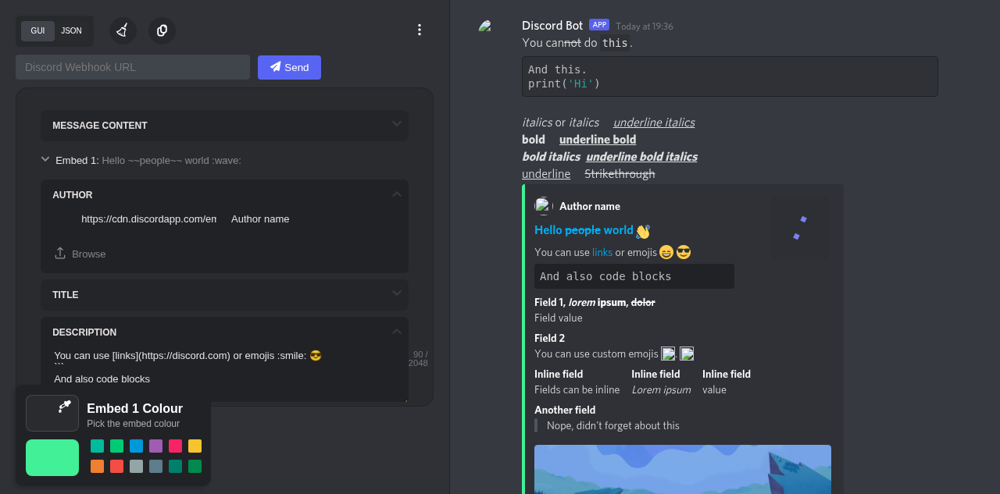
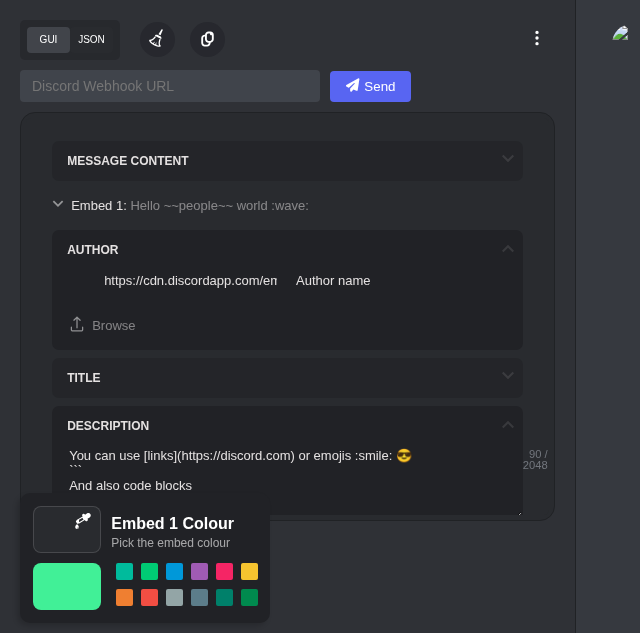
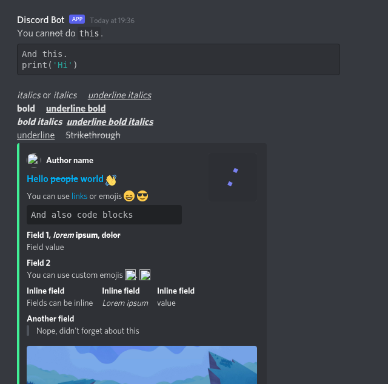

<div align="center">
  
  <h1>Discord Embed Builder</h1>
  <p>A pixel-accurate Discord embed editor. Build, preview, and send rich embeds to any webhook — no coding required.</p>

  <p>
    
    
    
    
  </p>
</div>

---



---

## Features

| | |
|---|---|
| 🎨 **Visual GUI editor** | Accordion panels for every embed field — author, title, description, fields, thumbnail, image, footer |
| 🔄 **Synced JSON editor** | CodeMirror-powered JSON view with live linting — GUI and JSON stay in sync at all times |
| 👁️ **Pixel-accurate preview** | Dark-theme Discord mockup with real Whitney font, correct field grid layout, markdown rendering |
| 🌈 **Color picker** | Hex input + 12 preset swatches + color wheel for the embed accent bar |
| 📎 **Multi-embed support** | Add, switch between, and delete multiple embeds in one message |
| 📝 **Character counters** | Live count on message content (2 000) and description (2 048) fields |
| 🔗 **Shareable URLs** | Encode full embed data into the page URL and share it with anyone |
| 💾 **JSON import / export** | Download your embed as a `.json` file or paste one to import |
| 🖼️ **Image upload** | Upload images via ImgBB and get a hosted URL back automatically |
| 🤖 **Webhook send** | Paste a webhook URL to preview the real bot name + avatar, then click Send |
| 😀 **Emoji shortcodes** | `:wave:` `:thumbsup:` and thousands more, rendered inline |
| 🔒 **Security hardened** | Helmet CSP, per-IP rate limiting, Discord-URL-only validation, no SSRF |

---

## Screenshots

<table>
  <tr>
    <td align="center"><strong>Editor panel</strong></td>
    <td align="center"><strong>Live preview</strong></td>
  </tr>
  <tr>
    <td></td>
    <td></td>
  </tr>
</table>

---

## Quick Start

### 1. Clone

```bash
git clone https://github.com/dknalp/discord-embed-builder.git
cd discord-embed-builder
```

### 2. Install dependencies

```bash
bun install
```

### 3. Configure environment

```bash
cp .env.example .env
```

Open `.env` and fill in your values:

```env
# Server port (default: 3000)
PORT=3000

# ImgBB API key for image uploads — get one free at https://api.imgbb.com
# Leave blank to disable image upload
IMGBB_API_KEY=your_imgbb_api_key_here
```

### 4. Run

```bash
# Development — auto-restart on file changes
bun run dev

# Production
bun run start
```

Open **[http://localhost:3000](http://localhost:3000)** in your browser.

---

## Usage

1. **Build** your embed using the GUI tabs (Author, Title, Description, Fields, Image, Footer) or switch to the JSON editor.
2. **Preview** updates in real time on the right — exactly how it will look in Discord.
3. **Paste a webhook URL** in the top bar — the preview bot name and avatar update to match.
4. **Click Send** to deliver the embed to your Discord channel.

> **Tip:** Hit the `⋯` menu to get a shareable URL, download JSON, swap editor/preview columns, or toggle multi-embed mode.

---

## Configuration (`builder.config.js`)

Customise the builder when embedding it in an iframe:

| Option | Default | Description |
|---|---|---|
| `username` | `'Discord Bot'` | Default preview username |
| `avatar` | Discord avatar 1 | Default preview avatar URL |
| `useJsonEditor` | `false` | Open in JSON editor mode |
| `reverseColumns` | `false` | Swap editor and preview sides |
| `single` | `false` | Single-embed mode only |
| `autoUpdateURL` | `false` | Continuously encode data into the URL |
| `hideEditor` | `false` | Hide the editor panel |
| `hidePreview` | `false` | Hide the preview panel |

---

## Tech Stack

| Layer | Technology |
|---|---|
| Server | **Node.js** + **Express 4** |
| Templates | **EJS** |
| Security | **helmet** (CSP, X-Frame-Options, …) + **express-rate-limit** |
| HTTP client | **axios** |
| Code editor | **CodeMirror 5** (JSON mode, material-darker, lint) |
| Icons | **Font Awesome 6** |
| Emoji | **Twemoji 14** |
| Fonts | Discord Whitney (self-hosted) |

---

## API Endpoints

| Method | Path | Description |
|---|---|---|
| `GET` | `/api/webhook-info?url=` | Fetch webhook name + avatar for preview |
| `POST` | `/api/send-webhook` | Send embed to a Discord webhook |

Both endpoints validate that the URL matches `https://discord.com/api/webhooks/{id}/{token}` before making any outbound request.

Rate limits: 60 requests / minute globally · 2 webhook sends / 10 seconds per IP.

---

## Contributing

1. Fork the repo
2. Create a feature branch: `git checkout -b feature/my-feature`
3. Commit: `git commit -m "feat: my feature"`
4. Push: `git push origin feature/my-feature`
5. Open a Pull Request

---

## License

[Apache-2.0](LICENSE)
