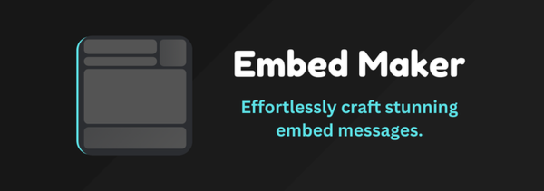

# Discord Embed Builder

<div align="center">
  
  <br/>
  <p> Advanced embed message builder for Discord</p>
</div>

## Features

- Visual GUI editor and raw JSON editor — stay in sync at all times
- Pixel-accurate Discord dark-theme preview
- Multi-embed support
- Color picker with live embed border update
- Image upload via [ImgBB](https://api.imgbb.com) (optional)
- Emoji shortcode support (`:wave:`, `:thumbsup:`, ...)
- Discord markdown rendering (bold, italic, code blocks, blockquotes, mentions, headings)
- Shareable URLs with embed data encoded in the query string
- Download embed as JSON / import from JSON
- Webhook send with live username + avatar preview
- Character count display on content and description fields
- Rate-limited API endpoints with security headers

## Tech Stack

- **Node.js** + **Express**
- **EJS** template engine
- **helmet** — security headers
- **express-rate-limit** — per-IP rate limiting
- **axios** — HTTP client
- **CodeMirror 5** — JSON editor
- **FontAwesome** — icons

## Setup

### 1. Clone

```bash
git clone https://github.com/dknalp/discord-embed-builder.git
cd discord-embed-builder
```

### 2. Install dependencies

```bash
bun install
```

### 3. Configure environment

```bash
cp .env.example .env
```

Edit `.env`:

```env
# Server port (default: 3000)
PORT=3000

# ImgBB API key for image uploads — get one at https://api.imgbb.com
IMGBB_API_KEY=your_imgbb_api_key_here
```

`IMGBB_API_KEY` is optional. Image upload is disabled when omitted.

### 4. Run

```bash
# Development (auto-restart on changes)
bun run dev

# Production
bun run start
```

Open [http://localhost:3000](http://localhost:3000) in your browser.

## Usage

1. Build your embed using the GUI tabs (Author, Title, Description, Fields, Image, Footer) or the JSON editor.
2. Paste your Discord webhook URL in the top bar — the preview updates to show the real webhook name and avatar.
3. Click **Send** to deliver the embed to your Discord channel.

## Configuration (builder.config.js)

`builder.config.js` is loaded before the main script and exposes an `options` object you can customise when embedding this tool in an iframe:

| Option | Default | Description |
|---|---|---|
| `username` | `'Discord Bot'` | Default preview username |
| `avatar` | Discord avatar 1 | Default preview avatar URL |
| `useJsonEditor` | `false` | Start in JSON editor mode |
| `reverseColumns` | `false` | Swap editor and preview sides |
| `single` | `false` | Single-embed mode only |
| `autoUpdateURL` | `false` | Continuously encode data into the URL |
| `hideEditor` | `false` | Hide the editor panel |
| `hidePreview` | `false` | Hide the preview panel |

## Contributing

1. Fork the repo
2. Create a feature branch: `git checkout -b feature/my-feature`
3. Commit: `git commit -m "feat: my feature"`
4. Push: `git push origin feature/my-feature`
5. Open a Pull Request

## License

Apache-2.0 — see [LICENSE](LICENSE).
